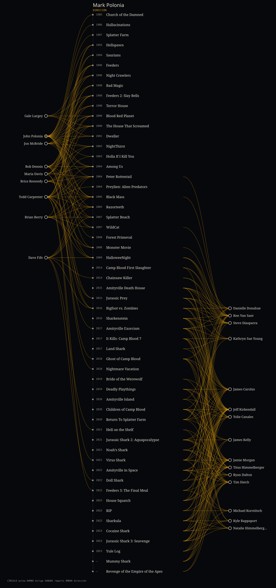

# Quién vuelve a trabajar

En los créditos facturados del terror, Mark Polonia y Jeff Kirkendall coinciden en 25 películas. Esta pieza cuenta quién vuelve a trabajar con quién, sin mezclar la nota de la película.

Por Juan Pablo Duque · Pulp Analytics

El terror parece una multitud. Cada año entran caras nuevas. Si uno se queda en los primeros nombres que este archivo guarda por película —la columna `cast` del dataset TMDB–IMDb, más la columna `directors` de la misma fila— el género se achica. Es un círculo que se vuelve a contratar.

Mark Polonia es el centro de la red de apertura porque, entre los dos extremos del vínculo más repetido, es quien acumula más películas. El vínculo con Jeff Kirkendall es de dirección y pesa 25. Las películas de esa línea: Cocaine Shark (2023), Jurassic Shark 3: Seavenge (2023), Yule Log (2023), Amityville in Space (2022), Feeders 3: The Final Meal (2022), House Squatch (2022), RIP (2022), Sharkula (2022) y 17 más.

La espina ordena esas películas por año. La sangre une a quien actuó junto. El ámbar une a quien dirigió con quien estuvo en el cartel. Cada curva es un crédito. El dibujo muestra solo la red de una persona: sus 24 compañeros más repetidos, si es que tiene tantos, y cada película que comparten. El resto se cuenta y no se dibuja.

## Quién acumula más películas

- Debbie Rochon: 148 películas (147 como reparto, 1 como dirección)
- Brinke Stevens: 117 películas (117 como reparto, 1 como dirección)
- Linnea Quigley: 94 películas (94 como reparto, 0 como dirección)
- Shawn C. Phillips: 89 películas (86 como reparto, 10 como dirección)
- Felissa Rose: 82 películas (82 como reparto, 0 como dirección)
- Eric Roberts: 81 películas (81 como reparto, 0 como dirección)
- John Carradine: 81 películas (81 como reparto, 0 como dirección)
- Dustin Ferguson: 79 películas (0 como reparto, 79 como dirección)

## Quién dirige a los mismos

- Mark Polonia dirige a Jeff Kirkendall — 25 películas. Cocaine Shark (2023), Jurassic Shark 3: Seavenge (2023), Yule Log (2023), Amityville in Space (2022) y 21 más
- Dustin Ferguson dirige a Breana Mitchell — 22 películas. Cocaine Cougar (2023), Doll Killer 3 (2023), The Creeps 2 (2023), Beyond the Gates of Hell (2022) y 18 más
- John Polonia y Mark Polonia se cruzan en la dirección — 22 películas. Forest Primeval (2008), Monster Movie (2008), Splatter Beach (2007), WildCat (2007) y 18 más
- Kôji Shiraishi dirige a Shigeo Ôsako — 21 películas. Senritsu Kaiki World Kowasugi! (2023), A Beast in Love (2020), Simokita 2014 (2017), Vauxhall Rideshow - Escape from Dead School (2016) y 17 más
- Jesús Franco dirige a Lina Romay — 20 películas. Incubus (2002), Killer Barbys vs. Dracula (2002), Vampire Junction (2001), Helter Skelter (2000) y 16 más
- Dustin Ferguson dirige a Jennii Caroline — 19 películas. VHS Violence (2021), Frames of Fear III (2020), I Drip Blood on Your Grave (2020), Tales for the Campfire 2 (2017) y 15 más
- Dustin Ferguson dirige a Shawn C. Phillips — 18 películas. Big Freakin’ Snake (2023), Demonoids from Hell (2023), The Beast Beneath (2023), Ebola Rex (2021) y 14 más
- Mark Polonia dirige a Todd Carpenter — 18 películas. Feeders 3: The Final Meal (2022), Virus Shark (2021), Amityville Exorcism (2017), Bigfoot vs. Zombies (2016) y 14 más

## Quién comparte el cartel

- Christopher Lee y Peter Cushing comparten cartel — 17 películas. House of the Long Shadows (1983), Nothing But the Night (1973), The Creeping Flesh (1973), The Satanic Rites of Dracula (1973) y 13 más
- Julie Anne Prescott y Shawn C. Phillips comparten cartel — 16 películas. Alien Vampire Busters (2023), Big Freakin’ Snake (2023), Demonoids from Hell (2023), Clown Motel 2 (2022) y 12 más
- Brinke Stevens y Debbie Rochon comparten cartel — 15 películas. Caesar and Otto's Paranormal Halloween (2015), Disciples (2014), Bloodstruck (2010), Under the Scares (2010) y 11 más
- Chika Kuboyama y Shigeo Ôsako comparten cartel — 14 películas. Senritsu Kaiki World Kowasugi! (2023), A Beast in Love (2020), Simokita 2014 (2017), Message From Beyond (2015) y 10 más
- James Carolus y Jeff Kirkendall comparten cartel — 13 películas. Jurassic Shark 3: Seavenge (2023), Feeders 3: The Final Meal (2022), RIP (2022), Jurassic Shark 2: Aquapocalypse (2021) y 9 más
- Brinke Stevens y Linnea Quigley comparten cartel — 13 películas. Death Heads: Brain Drain (2018), Disciples (2014), The 50 Best Horror Movies You've Never Seen (2014), Trophy Heads (2014) y 9 más
- Mike Ferguson y Shawn C. Phillips comparten cartel — 12 películas. Alien Vampire Busters (2023), The Beast Beneath (2023), Clown Motel 2 (2022), Night of the Zomghouls (2022) y 8 más
- Jamie Morgan y Jeff Kirkendall comparten cartel — 12 películas. Jurassic Shark 3: Seavenge (2023), Yule Log (2023), House Squatch (2022), Sharkula (2022) y 8 más

## Mi lectura

Los datos muestran quién vuelve, no por qué. El vínculo más repetido de este corte une a Mark Polonia y Jeff Kirkendall en Cocaine Shark (2023), Jurassic Shark 3: Seavenge (2023), Yule Log (2023), Amityville in Space (2022), Feeders 3: The Final Meal (2022), House Squatch (2022) y 19 más. Si los títulos se parecen, es una serie que conserva a su gente. Si no se parecen, es una compañía que se reúne aunque la película cambie de nombre. Las dos cosas caben en el mismo gráfico.

Esto no es la nómina completa. La mediana de nombres facturados por película es 8.0. Un extra que cruza el fondo no está. Tampoco hay un id de persona: la misma grafía es la misma persona, y dos personas que se escriben igual se cuentan como una.

## Fuentes y método

28648 películas de terror ya estrenadas, con Horror como género exacto, entre 1895 y 2024. Quedaron fuera las que TMDB marca como adultas y las que traen una palabra clave exacta de cine erótico o pornográfico: erotic movie, softcore, sexploitation, pink film, pornography, hentai, nunsploitation y variantes cercanas. Una película de terror con una escena sexual se queda. Torture porn se queda: es el nombre de la crítica para el terror violento, no una película para adultos. 145739 personas. Fuente: HenryWaltson/TMDB-IMDB-Movies-Dataset, columnas `cast` y `directors`. No se mezcló Letterboxd: una lista más larga en unas películas habría inflado a quien apareciera ahí. La espina ordena las películas por año y cada curva es un crédito con uno de los 24 compañeros más repetidos. La página interactiva deja elegir a otra persona y leer los títulos de cada curva.
